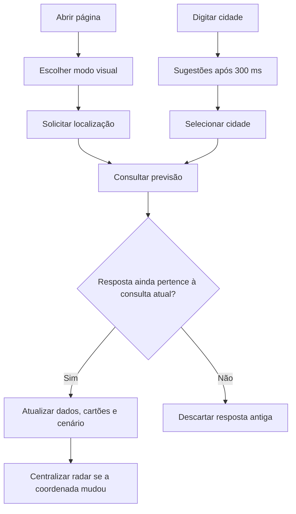

# 🌤️ Tempo LDZ

Site de previsão do tempo com localização do navegador, busca de cidades, previsão das próximas 12 horas, radar de chuva e cenário animado que acompanha as condições meteorológicas.

**Acessar:** [ludezam.github.io/tempoLDZ](https://ludezam.github.io/tempoLDZ/)

Desenvolvido por **LDZ**, com HTML, CSS e JavaScript puro. Não exige compilação, framework, banco de dados ou servidor de aplicação.

## Índice

- [Funcionalidades](#funcionalidades)
- [Como usar](#como-usar)
- [Dados e interpretação](#dados-e-interpretação)
- [Localização e privacidade](#localização-e-privacidade)
- [Aparência e modo leve](#aparência-e-modo-leve)
- [Estrutura e arquitetura](#estrutura-e-arquitetura)
- [APIs e dependências externas](#apis-e-dependências-externas)
- [Executar localmente](#executar-localmente)
- [Testes](#testes)
- [Publicação e cache](#publicação-e-cache)
- [Manutenção](#manutenção)
- [Solução de problemas](#solução-de-problemas)
- [Limitações e próximos passos](#limitações-e-próximos-passos)
- [Créditos e licença](#créditos-e-licença)

## Funcionalidades

- Localização automática, com autorização do navegador.
- Aproveitamento de uma posição obtida nos últimos cinco minutos na abertura.
- Botão **Meu Local** para solicitar uma posição nova.
- Sugestões de cidades enquanto o usuário digita, com estado e país.
- Busca automática ao selecionar uma sugestão; suporte a botão, Enter e setas.
- Temperatura, sensação térmica, umidade, velocidade e direção do vento.
- Precipitação atual e probabilidade horária de precipitação.
- Resumo de chuva e cartões horários para as próximas 12 horas.
- Nascer e pôr do sol e horário dos dados atuais.
- Radar RainViewer incorporado e links para satélite GOES/CPTEC e IPMet.
- Cenário de dia/noite com sol, lua, estrelas, nuvens, chuva e efeitos de tempestade.
- Modo leve para reduzir o custo visual em telas pequenas e equipamentos com poucos processadores lógicos.
- Atualização automática e proteção contra respostas atrasadas de outra cidade.

## Como usar

### Localização automática

1. Abra o site e permita acesso à localização.
2. O navegador retorna uma coordenada; o site consulta o clima desse ponto.
3. O cabeçalho mostra apenas **Local atual**. Coordenadas e precisão ficam ocultas; toque ou clique em **Mostrar localização** para consultar e em **Ocultar localização** para fechar.
4. Se a localização falhar, pesquise uma cidade manualmente.

A localização do computador pode ser estimada por rede/Wi-Fi e diferir da localização do celular. O site não força o uso de um sensor específico.

### Pesquisar uma cidade

1. Digite pelo menos **duas letras**.
2. Após **300 ms** sem nova digitação, o site consulta até **oito sugestões**.
3. Confira cidade, estado e país e selecione uma opção. O clima e o radar carregam automaticamente.

| Comando | Resultado |
| --- | --- |
| Clique ou toque na sugestão | Seleciona a cidade e carrega o clima |
| ↓ / ↑ | Percorre as sugestões |
| Enter com opção destacada | Seleciona essa opção |
| Enter sem opção destacada | Busca o primeiro resultado pelo texto digitado |
| Buscar Cidade | Busca o primeiro resultado pelo texto digitado |
| Escape ou Tab | Fecha as sugestões |
| Clique fora da busca | Fecha as sugestões |
| Meu Local | Solicita localização nova, sem aceitar posição em cache |
| Atualizar | Recarrega a página e reinicia a localização automática |
| Visual: leve / normal | Alterna os efeitos e cartões sem recarregar a previsão ou o radar |

**Atenção:** o botão Atualizar recarrega a página inteira. A cidade escolhida manualmente não é salva entre recarregamentos.

## Dados e interpretação

### Condição atual versus previsão

Os dados atuais e os horários futuros têm funções diferentes:

| Informação | Origem | Interpretação |
| --- | --- | --- |
| Temperatura | `current.temperature_2m` | Temperatura em °C |
| Sensação | `current.apparent_temperature` | Sensação térmica em °C |
| Umidade | `current.relative_humidity_2m` | Umidade relativa em % |
| Vento | `current.wind_speed_10m` | Velocidade em km/h |
| Direção | `current.wind_direction_10m` | Direção meteorológica em graus; a seta aplica rotação de 180° |
| Chuva atual | `current.precipitation` | Precipitação em mm no intervalo atual retornado pela API |
| Probabilidade | `hourly.precipitation_probability` | Probabilidade da hora que contém o horário dos dados atuais |
| Nebulosidade | `current.cloud_cover` | Cobertura de nuvens em % |
| Condição | `current.weather_code` | Código meteorológico WMO |
| Sol | `daily.sunrise` / `daily.sunset` | Horários de nascer e pôr do sol da cidade |

A consulta `current` utilizada não inclui probabilidade. Esse valor é obtido da série **horária**, com correspondência pela data e hora. Caso a hora não exista, o valor usado é zero.

A animação de gotas só aparece quando a precipitação atual é maior que zero ou o código atual indica garoa, chuva ou tempestade. **Uma chance elevada de chuva não cria, por si só, chuva no fundo.**

### Regras dos indicadores

A ordem de prioridade do indicador principal é:

1. Precipitação atual acima de **0,5 mm**: **Chuva Forte**.
2. Precipitação positiva ou código de chuva: **Chovendo agora**.
3. Probabilidade da hora atual acima de **40%**: **Chuva Chegando**.
4. Chuva prevista no resumo das 12 horas: **Chuva nas próximas horas**.
5. Nenhuma das condições acima: **Tempo Estável**.

Esses textos e limiares são regras de apresentação do projeto. O rótulo “Chuva Forte” não é uma classificação oficial de intensidade meteorológica nem um alerta de defesa civil.

O efeito de calor aparece quando a sensação térmica chega a **38 °C**. O modo leve conserva o cartão, mas desativa sua animação.

### Próximas 12 horas

- O primeiro cartão é a primeira hora da série igual ou posterior ao horário dos dados atuais. Exemplo: dados das **21:45** iniciam os cartões às **22:00**.
- São exibidos até 12 cartões disponíveis, com temperatura, código meteorológico, probabilidade e quantidade de precipitação.
- A quantidade total do resumo soma a precipitação dos mesmos 12 horários.
- Uma hora é contada como possibilidade de chuva se a chance passar de **10%** ou a quantidade passar de **0,1 mm**.
- “Chuva em três dessas horas” significa três horários com possibilidade de chuva dentro da janela, e não que a chuva começa daqui a três horas nem que será contínua.
- Os ícones de dia/noite usam nascer e pôr do sol da **data de cada cartão**, incluindo a passagem para o dia seguinte.

### Horários e fusos

A API usa `timezone=auto`, devolvendo horários civis da localização consultada. O código compara essas strings em uma base UTC artificial (`dataCidade`), sem convertê-las para o fuso do aparelho. Isso evita que o mesmo horário seja interpretado de maneira diferente no PC e no celular.

Essa base é uma ferramenta interna de comparação; **não significa que os horários exibidos sejam UTC**. Na interface, os horários pertencem à cidade consultada.

“Hora da atualização” é o horário de `current.time`, isto é, a referência temporal dos dados fornecidos pelo serviço. Não é o instante em que o navegador terminou de baixar a resposta. O cenário se baseia nessa referência e avança quando os dados são atualizados.

### Atualização e concorrência

- Clima: a cada **cinco minutos**, enquanto a página estiver visível.
- Retorno a uma aba: consulta novamente se a última atualização bem-sucedida tiver pelo menos cinco minutos.
- Ciclo visual de céu, sol/lua e estrelas: a cada **30 segundos**, com dados disponíveis e página visível.
- Consulta meteorológica: limite de **15 segundos**.
- Uma nova consulta aborta a anterior. Identificadores de consulta e localização impedem que uma resposta antiga substitua a cidade atual.
- Falhas HTTP e respostas incompletas mostram aviso na interface. Dados anteriores podem permanecer visíveis, acompanhados do aviso de possível desatualização.

## Localização e privacidade

A geolocalização utiliza `navigator.geolocation.getCurrentPosition` com:

```js
{
  enableHighAccuracy: true,
  timeout: 10000,
  maximumAge: forcarAtualizacao ? 0 : 300000
}
```

- A posição pode ter até cinco minutos na abertura; **Meu Local** solicita uma nova posição.
- `enableHighAccuracy` é uma preferência solicitada ao navegador, não uma garantia de GPS ou precisão.
- Não há gravação própria de coordenadas em `localStorage`, cookies ou banco de dados.
- As coordenadas são enviadas ao Open-Meteo e ao RainViewer para consultar clima e centralizar o mapa.
- Os nomes digitados são enviados à API de busca do Open-Meteo.
- O RainViewer é um site externo incorporado e pode carregar recursos próprios de terceiros; suas políticas se aplicam ao iframe.
- Links externos abrem em outra aba com `rel="noopener noreferrer"`.

O endpoint de busca do Open-Meteo não fornece geocodificação reversa em `/v1/reverse`. A tentativa anterior foi removida para evitar uma requisição que falhava. Por isso, na localização automática o site mostra **Local atual**, com coordenadas em um controle fechado por padrão; o nome da cidade aparece quando ela é selecionada na busca. Abrir um novo GPS ou escolher uma cidade fecha e limpa os detalhes. Os números não aparecem em títulos de elementos nem em textos acessíveis enquanto o controle está fechado. O radar continua centralizado na localização consultada.

## Aparência e modo leve

O layout é responsivo. O modo leve é escolhido na abertura conforme a regra:

```js
!dispositivoAppleMovel &&
(window.innerWidth < 700 || navigator.hardwareConcurrency <= 4)
```

`dispositivoAppleMovel` identifica iPhone/iPad/iPod e iPad com identificação de Mac e suporte a toque. Esses aparelhos preservam a aparência completa por decisão do projeto.

| Recurso | Completo | Leve |
| --- | --- | --- |
| Estrelas | 350, com cintilação | 120, sem cintilação |
| Nuvens | Até 38 elementos animados | Não são criadas; camadas ocultas |
| Chuva | 100 a 300 gotas para precipitação positiva; 120 se apenas o código indica chuva | Até 50 gotas, camada com opacidade de 18% |
| Neblina | Desfoque quando o código indica neblina | Camada oculta |
| Estrelas cadentes | À noite com pouca nebulosidade | Desativadas |
| Relâmpagos | Efeito eventual para códigos 95, 96 e 99 | Desativados |
| Cartões | Transparências e desfoques | Fundos opacos com maior contraste |
| Brilho de sol/lua | Sombras | Sem sombras externas |
| Radar | RainViewer automático | Mesmo RainViewer automático |

A capacidade é uma **heurística**, não um benchmark. Largura de tela e processadores lógicos não medem diretamente GPU, memória ou desempenho. A regra é avaliada ao abrir a página; redimensionar ou girar o aparelho não muda o modo automaticamente.

O botão discreto **Visual: leve / normal**, abaixo de **Atualizar**, permite alternar os modos em qualquer dispositivo, incluindo iPhone e PC. A troca atualiza imediatamente os cartões e efeitos, preservando a cidade, os dados, o GPS e o radar. Os temporizadores são registrados uma única vez e verificam o modo ativo, evitando duplicação ao alternar. A escolha manual vale apenas para a página atual: ao recarregar, o site volta à escolha automática.

Os elementos animados do fundo pausam quando a página fica oculta. O iframe externo tem seu próprio ciclo de execução, fora do controle do código local.

A área **Visualização**, com uma altura de tela, foi mantida para permitir observar o cenário abaixo das informações.

## Estrutura e arquitetura

```text
tempoLDZ/
├── index.html          # Estrutura, textos iniciais e carregamento dos recursos
├── style.css           # Layout, temas, animações e modo leve
├── script.js           # Localização, APIs, busca, dados e cenário
├── README.md           # Documentação do projeto
└── tests/
    └── browser.cjs     # Testes de integração em Chromium, com APIs simuladas
```

O JavaScript inicia em `DOMContentLoaded`. O estado fica no escopo desse evento e não é exposto como variável global de `window`.

### Fluxo principal



### Principais funções

| Função/estado | Responsabilidade |
| --- | --- |
| `iniciarGPS` / `usarGPS` | Obter posição inicial ou nova posição |
| `atualizarClima` | Consultar, validar e aplicar a previsão |
| `versaoLocalizacao` / `versaoConsultaClima` | Impedir aplicação de respostas antigas |
| `consultaClimaAtiva` | Cancelar consulta anterior com AbortController |
| `buscarCidade` / `selecionarCidade` | Busca por texto e seleção de coordenadas |
| `fecharSugestoes` | Cancelar sugestões pendentes e limpar a lista |
| `atualizarDescricao` / `atualizarInterface` | Resumo de chuva e dados principais |
| `renderizar12Horas` | Construir cartões com ícones por data e horário |
| `dataCidade` / `horarioEmMinutos` | Comparar horários da cidade sem usar o fuso do aparelho |
| `atualizarMapa` | Definir o endereço do RainViewer somente se necessário |
| `atualizarCeu` / `atualizarSolLua` | Cenário e posição visual dos astros |
| `gerarEstrelas` / `atualizarEstrelas` | Criar e mostrar estrelas |
| `atualizarNuvens` / `atualizarChuva` | Gerar os elementos meteorológicos |
| `atualizarNeblina` / `iniciarRelampagos` | Efeitos por código meteorológico |

## APIs e dependências externas

### Open-Meteo — previsão

Endpoint: `https://api.open-meteo.com/v1/forecast`

Parâmetros:

```text
latitude=<latitude>
longitude=<longitude>
current=temperature_2m,apparent_temperature,precipitation,wind_speed_10m,
        wind_direction_10m,relative_humidity_2m,cloud_cover,weather_code
daily=sunrise,sunset
hourly=temperature_2m,precipitation_probability,precipitation,weather_code
timezone=auto
forecast_days=2
```

Dois dias cobrem a previsão de 12 horas mesmo quando a página é aberta perto da meia-noite, com menos dados que a resposta padrão de sete dias.

### Open-Meteo — cidades

Endpoint: `https://geocoding-api.open-meteo.com/v1/search`

Parâmetros: `name`, `language=pt` e `count=8` para sugestões ou `count=1` para busca direta. O nome é codificado com `encodeURIComponent`. Respostas antigas de sugestões são descartadas e a consulta anterior é cancelada quando a digitação muda.

### RainViewer

```text
https://www.rainviewer.com/map.html?loc=<latitude>,<longitude>,10&oFa=0&layer=radar
```

O iframe é carregado automaticamente após uma previsão bem-sucedida. Ele mantém a URL e os parâmetros do projeto. Atualizações do clima para a mesma coordenada não recarregam o mapa inteiro; uma mudança de coordenada atualiza sua centralização.

### Outros links

- [Satélite GOES — CPTEC/INPE](https://www.cptec.inpe.br/dsat/)
- [Radar móvel IPMet](https://www.ipmetradar.com.br/2mobileGis.php)
- [Documentação Open-Meteo](https://open-meteo.com/en/docs)
- [Busca de cidades Open-Meteo](https://open-meteo.com/en/docs/geocoding-api)

Não há chave de API configurada no projeto. Uso, atribuição, limites e eventuais exigências comerciais devem seguir os termos vigentes de cada serviço.

## Executar localmente

Pré-requisitos: navegador moderno, internet para os dados reais e um servidor HTTP estático. Python 3 é uma opção:

```bash
git clone https://github.com/ludezam/tempoLDZ.git
cd tempoLDZ
python3 -m http.server 8000
```

Abra `http://localhost:8000`.

Geolocalização requer contexto seguro, normalmente HTTPS ou localhost. Evite abrir diretamente por `file://` ou pelo IP HTTP de outro computador. Para testar em um celular real, use uma hospedagem HTTPS acessível pelo aparelho.

Não há `npm run build`, pacote de produção ou variáveis de ambiente obrigatórias.

## Testes

O site não depende de Node.js para funcionar. Os testes opcionais usam Node.js moderno e Playwright:

```bash
npm install --no-save --package-lock=false playwright
npx playwright install chromium
node tests/browser.cjs
```

Em Linux, pode ser necessário instalar as dependências do navegador conforme a documentação do Playwright. Para usar um Chromium já instalado:

```bash
CHROMIUM_PATH=/usr/bin/chromium node tests/browser.cjs
```

A variável acima altera apenas o navegador usado no teste. Não afeta o site publicado.

O teste inicia um servidor local temporário, simula as APIs e fecha o servidor ao terminar. Não consulta clima real, não usa GPS real e não depende de a previsão meteorológica mudar.

Cenários cobertos:

- Desktop, perfil Android e perfil iPhone em Chromium.
- Escolha automática do modo completo nos perfis Apple e modo leve no Android.
- Alternância manual nos dois sentidos, sem nova previsão ou recarga de radar.
- Coordenadas ocultas por padrão, exibição explícita e ocultação ao trocar de localização.
- Temperatura, chuva atual, probabilidade horária e 12 cartões.
- Mesmo horário da cidade em fusos de dispositivo diferentes.
- Ícone diurno após a passagem para o dia seguinte.
- Sugestões por clique/toque e setas/Enter, busca direta e ausência de resultados.
- GPS inicial com cache de cinco minutos e botão GPS com posição nova.
- Mensagens distintas para permissão negada, posição indisponível e timeout de localização.
- Ausência da consulta inválida de geocodificação reversa.
- Radar sem recarga quando a coordenada não muda.
- Resposta antiga retida enquanto uma cidade mais recente é selecionada.
- Mensagem de erro em falha HTTP e ausência de exceções JavaScript não tratadas.

Validação de sintaxe independente:

```bash
node --check script.js
```

Os perfis móveis de Chromium **não substituem testes em Safari/iOS, Android físico e aparelhos de entrada**. O iframe é simulado nos testes; a disponibilidade e os controles internos do RainViewer precisam de conferência real.

## Publicação e cache

O site é servido pelo GitHub Pages em:

```text
https://ludezam.github.io/tempoLDZ/
```

Os arquivos de produção ficam na raiz do repositório. Commits na branch configurada no Pages disparam a publicação conforme as configurações do GitHub. Verifique **Settings → Pages** para confirmar a origem e **Actions → pages build and deployment** para acompanhar o resultado.

O `index.html` carrega CSS e JavaScript com um identificador de versão:

```html
<link rel="stylesheet" href="style.css?v=20261111-4">
<script defer src="script.js?v=20261111-4"></script>
```

Ao alterar os recursos, atualize esse identificador para evitar que navegadores reutilizem uma versão antiga. A publicação e a atualização dos caches não são instantâneas. O projeto não possui service worker.

## Manutenção

### Preservar o comportamento planejado

- Manter o RainViewer automático, com os mesmos parâmetros e controles externos.
- Preservar o visual completo em iPhones/iPads.
- Alterações no modo leve devem priorizar contraste, leitura e redução de trabalho de renderização.
- Manter proteção contra respostas atrasadas ao mudar de cidade.
- Não usar o fuso do aparelho para reinterpretar os horários civis retornados pela API.
- Não transformar probabilidade futura em evidência de chuva atual.
- Manter coordenadas ocultas por padrão e permitir exibição apenas por ação do usuário.
- Manter o modo automático na abertura e a opção manual sem recarga durante o uso.

### Antes de publicar

1. Executar a validação de sintaxe e os testes de navegador.
2. Conferir busca, GPS e radar com dados reais.
3. Conferir pelo menos um cenário de dia, noite e chuva.
4. Verificar legibilidade no modo leve e aparência completa em iPhone.
5. Atualizar a versão dos recursos no HTML.
6. Verificar o deployment do Pages e recarregar os aparelhos de teste.

### Otimizações aplicadas na revisão

- Redução da previsão solicitada para dois dias.
- Cancelamento e limite de tempo nas requisições meteorológicas.
- Descarte de respostas de outra consulta ou localização.
- Reutilização do iframe quando o ponto consultado não muda.
- Remoção da chamada de geocodificação reversa inválida.
- Remoção de modal, botão comentado e CSS de tela cheia sem implementação.
- Remoção de função, variável, camada vazia, logs extensos e chamadas duplicadas sem uso.
- Criação das estrelas em fragmento, com a paleta definida uma única vez.
- Não criação de nuvens ocultas no modo leve.
- Limite mínimo de duração para nuvens, evitando animações com duração negativa em ventos fortes.
- Remoção do temporizador duplicado de estrelas.
- Pausa de efeitos e consultas periódicas com página oculta.
- Tratamento de Enter centralizado no JavaScript, sem evento inline duplicado.
- Correção da animação do pseudoelemento de calor no modo leve.

## Solução de problemas

| Sintoma | Verificação e ação |
| --- | --- |
| PC e celular discordam | Selecione a mesma cidade/estado/país, confira hora dos dados e coordenadas. Recarregue após a publicação. GPS pode retornar pontos distintos. |
| GPS negado | Habilite permissão para o domínio ou use a busca manual. |
| GPS indisponível ou lento | Confira serviços de localização, conexão e contexto HTTPS. Após 10 segundos há erro; a busca continua disponível. |
| Nome aparece como Local atual | É o comportamento do GPS; selecione a cidade na busca para exibir seu nome ou abra Mostrar localização para conferir as coordenadas. |
| Sugestões não aparecem | Digite ao menos duas letras, aguarde 300 ms e confira conexão/bloqueios à API de geocodificação. |
| Nenhum resultado | Tente o nome completo e confira acentuação, estado e país. Há cidades homônimas. |
| Clima não atualiza | Confira conexão, aviso na interface e resposta de `api.open-meteo.com` na aba Network. Há timeout de 15 segundos. |
| Radar vazio | Verifique bloqueadores, conexão e disponibilidade do RainViewer. O iframe tem execução independente do resumo. |
| Radar e previsão discordam | Serviços distintos podem usar fontes, resoluções, instantes e métodos diferentes. Compare referências temporais. |
| Visual antigo após commit | Aguarde o deployment e recarregue. Verifique o identificador `v` no HTML e tente recarga completa. |
| Mesmo local com tempos diferentes | Atualizações em instantes distintos podem receber saídas diferentes do modelo. “Hora da atualização” representa os dados, não o download. |

Para relatar um erro, informe navegador, sistema, cidade/estado/país, se foi GPS ou busca, horário exibido e um print. Coordenadas e precisão ajudam a investigar divergências de localização.

## Limitações e próximos passos

- O clima é fornecido por modelos/serviços externos; não equivale a uma medição presencial nem garante chuva em uma rua específica.
- Não há funcionamento offline, histórico, cidade favorita persistida ou notificações.
- Não há nome automático de cidade por GPS; adicionar isso requer avaliar um serviço reverso válido e seus termos.
- O posicionamento do sol, a fase lunar e os efeitos são aproximações visuais, não efemérides astronômicas de precisão. O ciclo noturno aproxima o nascer seguinte com um dia de diferença.
- Datas são tratadas como horários civis. Horas repetidas em transições de horário de verão não têm identificação de offset individual nesse formato.
- Regiões polares podem ter nascer/pôr do sol ausentes; não há tratamento astronômico específico para dia/noite polar.
- O modo visual é uma heurística e depende da identificação fornecida pelo navegador.
- A aparência completa conserva efeitos caros de propósito; não há promessa de desempenho idêntico em todos os aparelhos.
- A disponibilidade dos provedores, seus limites e a compatibilidade do iframe são externos ao projeto.
- O botão de tela cheia próprio não foi implementado; o código inativo foi removido. O atributo `allowfullscreen` do radar permanece disponível para recursos do próprio provedor.

## Créditos e licença

- Desenvolvimento: **LDZ**.
- Previsão e busca de cidades: **Open-Meteo**.
- Radar incorporado: **RainViewer**.
- Links complementares: **CPTEC/INPE** e **IPMet**.

Este README não concede uma licença de software. Não há arquivo `LICENSE` definido no repositório nesta revisão; uma licença explícita pode ser adicionada pelo responsável pelo projeto. Os dados e conteúdos externos continuam sujeitos às licenças e aos termos de seus respectivos provedores.

